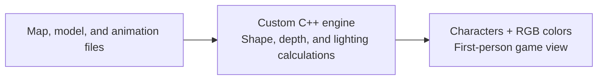
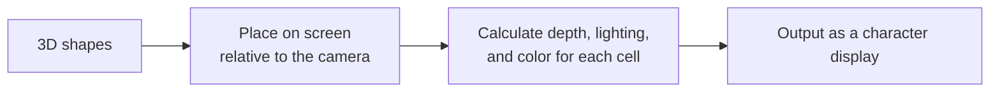
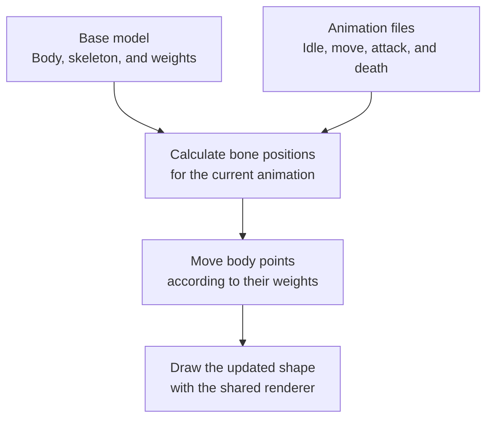
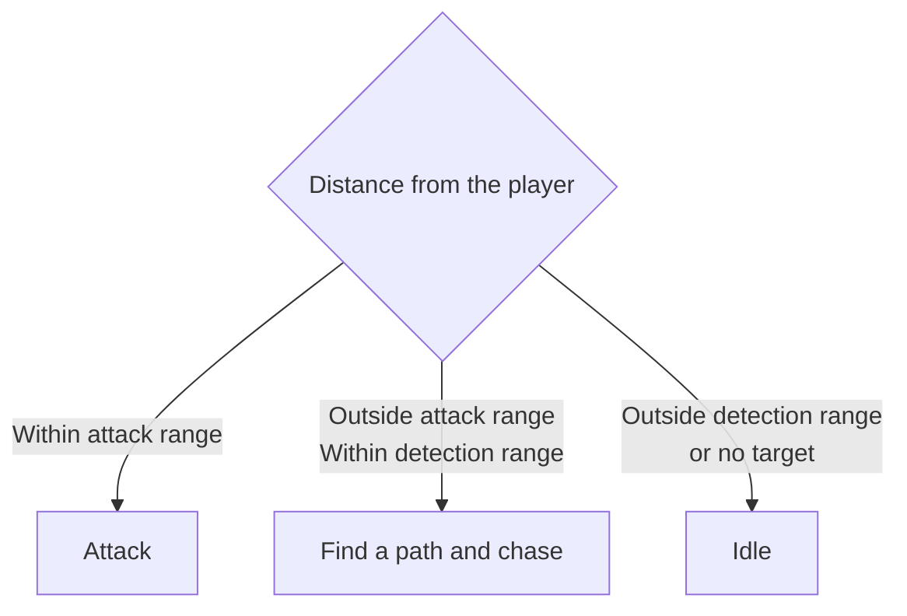
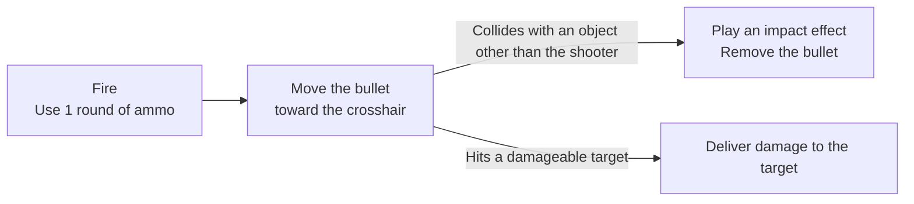
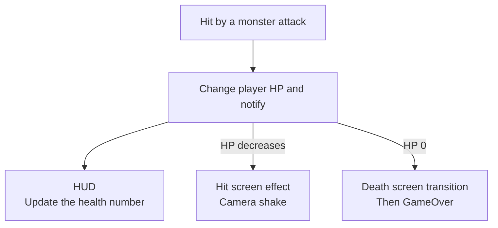
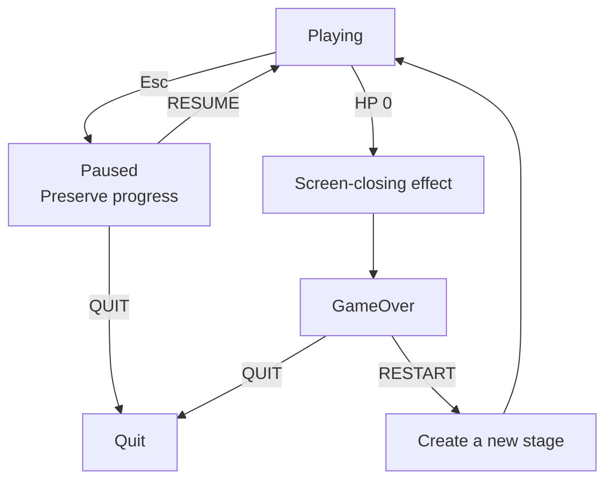

<p align="right">
  <a href="README.md"></a>
  <a href="README.en.md"></a>
</p>

# ASCII Doom

https://github.com/user-attachments/assets/31e2e76d-bf96-4367-9f9f-1c5504e425ce

[Download the game · v0.2.0 (Windows x64)](https://github.com/heewoung-lee/HiwoongEngine/releases/tag/v0.2.0)

**A first-person game that renders 3D spaces with characters and RGB colors using a custom C++ engine.**



| Category | Details |
|---|---|
| Technology | C++17 · Windows API · GDI |
| Runtime target | Windows x64 · Release |
| Custom implementation | Rendering, pathfinding, model data conversion, and game logic |
| Third-party code | FBX reading: [ufbx](../HiwoongEngine/AsciiDoomCore/ThirdParty/ufbx.h) / PNG reading: [stb_image](../HiwoongEngine/AsciiDoomCore/ThirdParty/stb_image.h) |

## Main Features

| What you can do in the game | Supporting features |
|---|---|
| Explore the map | TXT-based placement, wall and prop collisions, flashlight and ceiling lights |
| Fight monsters | 3D animation, path following, shooting and melee attacks, damage and death |
| Check your status | Health and ammo HUD, hit screen effects and camera shake |
| Pause and continue | Pause and resume |
| Start again after dying | GameOver, restart, and quit |

The gameplay loop is exploration → combat → death → restart. There is no separate stage-clear or victory condition.

## Core Implementation

The feature videos show the implementations at the time they were developed. The latest integrated gameplay is shown in the video at the top of this document.

### Turning 3D Shapes into a Character Display

**The engine places 3D shapes on the screen and calculates the character and color for each cell.**



| Calculation | Visible result |
|---|---|
| Projection and clipping | Places the shapes visible to the camera on the screen |
| Depth testing | Nearby objects hide objects behind them |
| Brightness → character density | Uses different characters based on the amount of light |
| Texture and light colors → RGB | Represents wall and model materials and lighting colors |

```text
Dark                                        Bright
  space   .   :   -   =   +   *   #   %   @
```

Meshes and 3D sprites share projection, clipping, and depth handling. Each render component provides its own method for choosing characters and colors.

### Flashlight Shading

https://github.com/user-attachments/assets/5a2b94c3-1b5d-4a2d-8865-a76ca032c596

### Per-Cell Colors

https://github.com/user-attachments/assets/b942b436-fb5e-4eb5-ae30-a69bb85c9eeb

Related code: [Shared renderer](../HiwoongEngine/src/Render/MeshRenderer.cpp), [Character and texture selection](Component/MeshRenderComponent.cpp), [Window output](../HiwoongEngine/src/Render/WindowRenderOutput.cpp)

### Animating a 3D Model with Bone Movement

**Skinning is the calculation that moves points on a model's body along with its bones.**



| Data | Meaning |
|---|---|
| Mesh | Points and triangles that make up the body |
| Joints and weights | Which bones move each point, and by how much |
| Animation clip | Bone movement over time |

The `Idle`, `Move`, `Attack`, and `Dead` clips are attached to the Zombie base model. Poses and skinning are calculated on the CPU, and `ModelAnimationComponent` connects playback to the rendered result.

### Loading an FBX Model

https://github.com/user-attachments/assets/beae9df2-e230-4d57-ae9d-7412b1c976b0

### Applying UV Mapping

https://github.com/user-attachments/assets/9676c227-d0d1-4a04-aa30-9be947be6c2f

### Playing Skeletal Animation

https://github.com/user-attachments/assets/745eb1be-686a-4f3c-84c6-df437a77ef4b

Related code: [Model and clip loading](Main.cpp), [Model data conversion](../HiwoongEngine/AsciiDoomCore/ModelImport), [Pose and skinning calculations](../HiwoongEngine/AsciiDoomCore/Animation), [Animation playback](Component/ModelAnimationComponent.cpp)

### Monster Behavior Based on Distance

**Monsters choose to idle, chase, or attack based on their distance from the player.**



| Responsible object or component | Role |
|---|---|
| Monster | Chooses behavior, moves along the path, and decides when to recalculate it |
| NavAIComponent·IPathFinder | Calculates a path from the current position to the destination |
| ModelAnimationComponent | Plays the selected animation |
| AttackObject | Delivers damage to targets that collide during the active part of an attack |

A* finds paths in the four cardinal and diagonal directions, while preventing diagonal movement through wall corners.

**Hit detection window during an attack animation**

| Start–45% | 45–50% | 50–100% |
|---|---|---|
| Wind-up | Delivers damage to targets on collision | Follow-through |

Distance conditions are evaluated again after the attack animation ends. When HP reaches 0, the attack is interrupted immediately and the death animation plays. The monster is removed after a set delay following the end of that animation.

The two videos below were recorded when monsters were implemented with 2D sprites.

### Adding Pathfinding

https://github.com/user-attachments/assets/e4fcf815-cd4e-40b7-b00a-c392d1a5de45

### Switching Animations Based on Behavior

https://github.com/user-attachments/assets/5fe08a5e-9f18-4f6a-a9cd-0fca11ac458e

Related code: [Behavior and movement](GameObject/Monster.cpp), [Path requests](Component/NavAIComponent.cpp), [A* search](../HiwoongEngine/AsciiDoomCore/PathFinder/Implements/AStarPathFinder.cpp), [Attack damage](GameObject/AttackObject.cpp)

### Shooting, Taking Damage, and Screen Feedback

**Shooting creates a bullet, and collisions trigger damage and effects.**



### Bullet Impact Effects

https://github.com/user-attachments/assets/98f8e1cd-fc63-4a95-9056-60def4282a98

**When the player's health changes, each relevant feature receives a notification.**



| Action | Handling |
|---|---|
| Deliver damage | Uses the `IDamageable` contract. Does not process the same target more than once per attack |
| Reload | Refills ammo to the maximum after the reload animation ends |
| Ammo HUD | Updates the display only when the ammo value actually changes |

### Player Hit Effects

https://github.com/user-attachments/assets/0ebdb595-f1f2-4d75-a93b-43893689d83a

Related code: [Gun](Player/Gun.cpp), [Bullet](GameObject/Bullet.cpp), [Damage contract](Interfaces/IDamageable.h), [HUD](UI), [Player hit effects](Component/PlayerHitEffectComponent.cpp)

### Pausing and Restarting the Game



| Selection | Game state |
|---|---|
| RESUME | Returns to the same preserved Scene. Retains position, HP, and ammo |
| RESTART | Creates a new Scene. Reuses pathfinding and loaded model data |

### Pause Menu

https://github.com/user-attachments/assets/472910dd-32d5-4a0f-b779-d556f6dc4e8c

### GameOver Screen

https://github.com/user-attachments/assets/56c527b8-fe3b-4dcb-b732-2340e3464220

Related code: [Pause menu](Scene/MenuScene.cpp), [Death and restart flow](Scene/DoomScene.cpp), [GameOver menu](Scene/GameOverScene.cpp)

## Problem-Solving Process

### Testing Without the Engine Loop: TDD and Dependency Injection

When complex logic such as the pathfinding algorithm and FBX Loader can only be checked in the game, every test requires setting up the map and objects and running the engine loop. An environment was needed to check algorithm and data conversion errors separately from movement and rendering issues.

To address this, the core logic was placed in `AsciiDoomCore`, and `AsciiDoomTests` was set up to call it directly without running the game. **The pathfinding algorithm and FBX Loader were developed using TDD:** expected results were written as tests first, then implementations and changes were verified against them. Small grids were used to check pathfinding, while model data was used to test vertex, UV, and triangle conversion, among other things.

**DI (dependency injection)** was used to connect this logic to the game. `DoomInstaller` creates and assembles the implementations, then passes them to consumers through the `IPathFinder` and `IModelImporter` interfaces. This lets the game use the same logic verified by tests while separating the responsibility for creating implementations from the responsibility for using them.

Related code: [Test entry point](../HiwoongEngine/AsciiDoomTests/Main.cpp), [Pathfinding tests](../HiwoongEngine/AsciiDoomTests/PathFinder/AStarPathFinderTests.cpp), [FBX Loader tests](../HiwoongEngine/AsciiDoomTests/ModeImport/MeshLoaderTests.cpp), [Dependency assembly](Bootstrap/DoomInstaller.cpp)

## Running the Game and Controls

### Download and Run

[Download the game · v0.2.0 (Windows x64)](https://github.com/heewoung-lee/HiwoongEngine/releases/tag/v0.2.0)

1. Download `AsciiDoom-Portable-20261022.zip` from **Assets** on the release page.
2. Extract the entire ZIP file.
3. Run `Start-Game.cmd` in the extracted folder.

Asset notices: [Environment asset license](Assets/Environment/CeilingLight/LICENSE.txt), [Freedoom texture notice](Assets/Textures/Freedoom/COPYING.adoc)

### Controls

| What you want to do | Input |
|---|---|
| Move | `W` forward · `S` backward · `A` left · `D` right |
| Turn the view | Move the mouse left/right or use `Q` / `E` |
| Move the crosshair up/down | Move the mouse up/down. Movement range is limited |
| Fire / reload | Left mouse click / `R`. Clicking with no ammo also requests a reload |
| Pause / resume | `Esc` |
| Select / activate a menu item | `↑`·`↓` / `Enter` |

## Development Log

Expand each entry to watch the demo from that stage of development. Early monster videos use 2D sprites; Step 14 onward covers the transition to 3D meshes and animation.

<details>
<summary>Step 1. Map Rendering and Player Movement</summary>

https://github.com/user-attachments/assets/865c266e-8450-480e-a423-dcdda1b79d45

</details>

<details>
<summary>Step 2. Flashlight</summary>

https://github.com/user-attachments/assets/5a2b94c3-1b5d-4a2d-8865-a76ca032c596

</details>

<details>
<summary>Step 3. Gun and Crosshair Display</summary>

https://github.com/user-attachments/assets/ad7fd86f-5ee3-47ba-800e-8a30ebba1aff

</details>

<details>
<summary>Step 4. Pause Menu</summary>

https://github.com/user-attachments/assets/472910dd-32d5-4a0f-b779-d556f6dc4e8c

</details>

<details>
<summary>Step 5. Hiding the Mouse Cursor</summary>

https://github.com/user-attachments/assets/da1e2ae7-e510-43eb-9f87-d4b80016d05d

</details>

<details>
<summary>Step 6. HP·AMMO UI</summary>


</details>

<details>
<summary>Step 7. Firing Animation</summary>

https://github.com/user-attachments/assets/add28a26-4993-4756-ac9e-6a16d6e0a38a

</details>

<details>
<summary>Step 8. Reload Animation</summary>

https://github.com/user-attachments/assets/4a433b47-2877-48de-bc82-da66d511ef53

</details>

<details>
<summary>Step 9. Bullet Firing and Impact Effects</summary>

https://github.com/user-attachments/assets/98f8e1cd-fc63-4a95-9056-60def4282a98

</details>

<details>
<summary>Step 10. Enemy Test</summary>

https://github.com/user-attachments/assets/4320f76c-edb7-43d7-a17d-4f33a0b32d38

</details>

<details>
<summary>Step 11. Pathfinding Algorithm</summary>

https://github.com/user-attachments/assets/e4fcf815-cd4e-40b7-b00a-c392d1a5de45

</details>

<details>
<summary>Step 12. Switching Animation States</summary>

https://github.com/user-attachments/assets/5fe08a5e-9f18-4f6a-a9cd-0fca11ac458e

</details>

<details>
<summary>Step 13. Per-Cell Color Display</summary>

https://github.com/user-attachments/assets/b942b436-fb5e-4eb5-ae30-a69bb85c9eeb

</details>

<details>
<summary>Step 14. Transitioning Monsters from 2D Sprites to 3D Meshes</summary>

**1. Loading an FBX Mesh**

https://github.com/user-attachments/assets/beae9df2-e230-4d57-ae9d-7412b1c976b0

**2. UV Mapping**

https://github.com/user-attachments/assets/9676c227-d0d1-4a04-aa30-9be947be6c2f

**3. Animation**

https://github.com/user-attachments/assets/745eb1be-686a-4f3c-84c6-df437a77ef4b

https://github.com/user-attachments/assets/29db8578-6d9d-4685-bcf5-1cb5c9d7054f

https://github.com/user-attachments/assets/a587d522-dd43-43e6-b936-a2b5dfd70ab4

https://github.com/user-attachments/assets/1a291b9e-4f09-4719-a87f-283d3b530960

</details>

<details>
<summary>Step 15. Debugging Tools</summary>

https://github.com/user-attachments/assets/8c2243a4-dbe0-4dff-b0a9-fcb99bb69736

</details>

<details>
<summary>Step 16. Hit Effects (Sprite Animation + Camera Shake)</summary>

https://github.com/user-attachments/assets/0ebdb595-f1f2-4d75-a93b-43893689d83a

</details>

<details>
<summary>Step 17. GameOver UI</summary>

https://github.com/user-attachments/assets/56c527b8-fe3b-4dcb-b732-2340e3464220

</details>
