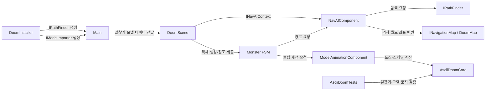

# ASCII Doom

**직접 제작한 C++ 게임 엔진 HiwoongEngine으로 3D 공간을 문자와 RGB 색상으로 표현하는 1인칭 게임입니다.**

CPU에서 정점 변환, 삼각형 래스터화, 깊이 판정과 조명을 계산하고, 그 결과를 ASCII 문자 셀로 출력합니다. 공통 엔진의 Scene·GameObject·Component 구조 위에 TXT 맵, 무기, 3D 몬스터와 HUD를 구성했습니다.

작은 평면 맵 하나, 총 한 종류, 몬스터 한 종류를 사용하는 단일 스테이지 데모를 개발하고 있습니다.

<!-- 최신 대표 화면과 통합 플레이 영상은 촬영 후 이 위치에 추가합니다. -->

**기술 구성:** C++17 · Windows API · GDI · CPU 소프트웨어 렌더링

FBX 파싱에는 [ufbx](../HiwoongEngine/AsciiDoomCore/ThirdParty/ufbx.h), PNG 읽기에는 [stb_image](../HiwoongEngine/AsciiDoomCore/ThirdParty/stb_image.h)를 사용합니다. 모델 데이터를 엔진 형식으로 변환하는 로더, 관절 포즈·스키닝 계산, 렌더링, 길찾기와 게임 로직은 직접 구현했습니다.

[현재 구현](#현재-구현과-개발-상태) · [핵심 구현](#핵심-구현) · [문제 해결](#문제-해결-과정) · [구조와 역할](#전체-구조와-역할) · [실행과 조작](#실행과-조작) · [개발 기록](#개발-기록)

## 현재 구현과 개발 상태

| 분야 | 구현 내용 |
|---|---|
| 3D 렌더링 | 원근 투영, 근평면 클리핑, 뒷면 제거, 삼각형 래스터화, 깊이 버퍼 |
| 색상·재질·조명 | RGB 문자 셀, PNG 텍스처의 UV 매핑, 손전등과 천장 조명 |
| 맵·이동 | TXT 기반 벽·바닥·천장과 소품 배치, WASD 이동, 벽을 따라 미끄러지는 이동 검사 |
| 무기 | 조준점 방향으로 탄환 발사, 발사·재장전 애니메이션, 탄약 소비와 재장전 |
| 3D 몬스터 | FBX 모델·애니메이션 로딩, CPU 스키닝, Idle·Move·Attack·Dead 재생 |
| 추적·전투 | 대각선 A* 경로 추적, 거리 기반 FSM, 공격 애니메이션 이벤트, 충돌 피해와 사망 후 제거 |
| HUD·피격 효과 | HP·AMMO 변경 알림에 따른 표시 갱신, 피격 화면 효과와 카메라 흔들림 |
| 메뉴·게임 흐름 | 상태를 보존하는 일시정지·재개, 플레이어 사망 시 GameOver, 재시작·종료 |
| 디버깅 | Debug 빌드에서 F3로 콜라이더 표시 전환 |

현재는 이동·사격·몬스터 추적과 전투·플레이어 사망·재시작을 연결한 상태입니다. 모든 몬스터 처치나 탈출에 따른 스테이지 클리어·승리 조건은 아직 구현하지 않았습니다.

## 핵심 구현

### 공통 3D 렌더링과 RGB 문자 출력

`DoomScene`은 카메라의 View·Projection과 광원 정보를 구성하고, `IRenderable3D`를 구현한 컴포넌트를 공용 `MeshRenderer`에 전달합니다. 각 컴포넌트는 메시, 모델 행렬과 표면의 문자·색상을 제공하며, 투영·클리핑·깊이 계산은 같은 렌더러를 사용합니다.

```text
정점의 Model·View 변환
    → 근평면 클리핑
    → 원근 투영
    → 화면 셀별 깊이·UV·공간 위치 계산
    → 조명에 따른 문자와 RGB 색상 계산
    → 깊이 판정과 문자 셀 출력
```

메시의 밝기는 [ShaderData](../HiwoongEngine/src/Render/ShaderData.h)의 10단계 문자 밀도로 표현합니다. 재질 색상은 UV로 PNG에서 읽고, 텍스처가 없으면 설정된 색상을 사용합니다. 공통 렌더러가 광원의 RGB를 반영한 뒤 GDI 기반 `WindowRenderOutput`으로 출력합니다.

손전등은 플레이어 위치와 카메라 정면을 따르고, 천장 조명은 맵에 배치된 위치·방향·색상·범위로 계산합니다. 문자 셀의 가로·세로 비율은 3D 투영의 화면 비율에도 반영합니다.

관련 코드: [DoomScene](Scene/DoomScene.cpp), [MeshRenderer](../HiwoongEngine/src/Render/MeshRenderer.cpp), [MeshRenderComponent](Component/MeshRenderComponent.cpp), [WindowRenderOutput](../HiwoongEngine/src/Render/WindowRenderOutput.cpp)

### TXT 맵과 이동·충돌

[Level01.txt](Assets/Maps/Level01.txt)의 문자 하나를 타일 생성 규칙에 연결합니다. 같은 TXT에서 벽·소품·조명과 플레이어·몬스터의 시작 위치를 관리합니다.

| 문자 | 배치 내용 | 길찾기 통과 |
|---|---|---|
| `#` | 벽 메시와 충돌체 | 불가 |
| `.` | 빈 공간 | 가능 |
| `P` | 플레이어 시작점 | 가능 |
| `M` | 몬스터 시작점 | 가능 |
| `C` | 상자 모델과 충돌체 | 불가 |
| `B` | 드럼통 모델과 충돌체 | 불가 |
| `I` | 기둥 모델과 충돌체 | 불가 |
| `H` | 천장 높이의 보 모델과 충돌체 | 가능 |
| `L` | 천장 조명 모델·충돌체와 광원 | 가능 |

`DoomMap`이 파일을 읽으면 `TileBuilderRegistry`가 문자에 해당하는 `ITileBuilder`를 선택합니다. 벽은 이웃 벽에 가려지는 측면을 삼각형 목록에서 제외합니다. 소품은 공용 `ModelTileBuilder`와 `MapPropObject`를 재사용하며, 모델 정점 범위로 충돌체 크기를 구합니다.

길찾기 격자의 통과 여부와 실제 이동 충돌은 별도로 처리합니다. 천장에 있는 `H`·`L` 칸은 경로 탐색을 허용하고, 실제 이동은 `Scene::CanMoveTo()`와 공통 `CollisionSystem`의 AABB 충돌 검사로 판단합니다.

플레이어 이동은 방향을 정규화하고 `deltaTime`을 반영합니다. 이동 예정 위치를 X축과 Z축으로 나누어 검사하므로, 한 축이 막혀도 다른 축으로 이동해 벽을 따라 미끄러질 수 있습니다.

관련 코드: [DoomMap](Map/DoomMap.cpp), [타일 빌더](Map/BuildImplements), [MapPropObject](GameObject/MapPropObject.cpp), [Player](Player/Player.cpp), [CollisionSystem](../HiwoongEngine/src/Physics/CollisionSystem.cpp)

### FBX 모델과 관절 애니메이션

FBX에서 메시·UV·재질, 관절 계층과 정점별 가중치를 읽어 `ModelData`로 변환합니다. 현재 진입점은 `Assets/Model/Zombie/`의 기준 모델에 별도 FBX의 `Idle`·`Move`·`Attack`·`Dead` 클립을 추가합니다.

```text
FBX 읽기
    → 메시·관절·가중치·애니메이션 데이터 변환
    → 현재 클립과 시간에 맞는 관절 포즈 계산
    → 가중치를 적용한 CPU 스키닝
    → MeshRenderComponent의 정점 위치 갱신
    → 공통 3D 렌더러로 출력
```

`ModelAnimationComponent`가 클립 재생·포즈 적용·애니메이션 이벤트를 담당합니다. 관절 행렬과 스키닝 계산은 `AsciiDoomCore`에 두고, 게임 컴포넌트는 계산 결과를 렌더러에 전달합니다.

관련 코드: [Main](Main.cpp), [모델 임포트](../HiwoongEngine/AsciiDoomCore/ModelImport), [포즈·스키닝 계산](../HiwoongEngine/AsciiDoomCore/Animation), [ModelAnimationComponent](Component/ModelAnimationComponent.cpp)

### 몬스터 FSM과 길찾기·공격

`NavAIComponent`는 시작·목적지의 월드 좌표를 받아 격자 좌표로 변환하고, `IPathFinder`에서 구한 경로를 월드 좌표 목록으로 반환합니다. A*는 직접 만든 최소 힙을 사용하며, 직선 비용 10·대각선 비용 14와 벽 모서리 통과 방지를 적용합니다.

`Monster`의 FSM이 대상과의 거리에 따라 Idle·Run·Attack·Dead 상태를 선택합니다. Run에서는 경로를 요청해 경유점을 따라 이동하고, 이동이 충돌로 막히면 경로를 비워 다시 탐색합니다. 길찾기 컴포넌트는 경로 계산을, Monster는 이동·공격 판단을 담당합니다.

공격 애니메이션의 지정 시점에 `AttackObject`를 활성화하고 종료 시점에 비활성화합니다. 공격 객체는 충돌한 `IDamageable`에 피해를 전달하며, 같은 공격에서 이미 맞은 대상은 다시 처리하지 않습니다. 몬스터는 HP가 0이 되면 공격을 종료하고, 사망 애니메이션이 끝난 뒤 일정 시간이 지나면 제거됩니다.

관련 코드: [Monster](GameObject/Monster.cpp), [NavAIComponent](Component/NavAIComponent.cpp), [AStarPathFinder](../HiwoongEngine/AsciiDoomCore/PathFinder/Implements/AStarPathFinder.cpp), [AttackObject](GameObject/AttackObject.cpp), [IDamageable](Interfaces/IDamageable.h)

### 무기·HUD·피격 효과

`Gun`은 발사 애니메이션 재생이 받아들여지면 조준점 방향으로 `Bullet`을 생성하고 탄약을 소비합니다. 재장전 애니메이션이 끝나면 탄약을 최대치로 채웁니다. 탄환은 발사자와의 충돌을 제외하고, `IDamageable` 대상에 피해를 전달한 뒤 충돌 효과를 생성하고 제거됩니다.

HP·AMMO 표시 컴포넌트는 Player의 값 변경 콜백을 구독합니다. `BigTextDisplayComponent`가 수치를 5×5 문자 패턴으로 확장하며, 값이 실제로 바뀔 때 HUD를 갱신합니다. 총·조준점·HUD는 3D 장면 위에 2D 스프라이트로 표시합니다.

`PlayerHitEffectComponent`도 HP 변경 알림을 구독합니다. 이전보다 HP가 감소하면 피격 화면 애니메이션과 카메라 흔들림을 요청합니다. 충돌 효과와 화면 효과는 기존 스프라이트 렌더러·애니메이션 컴포넌트를 재사용합니다.

관련 코드: [Gun](Player/Gun.cpp), [Bullet](GameObject/Bullet.cpp), [EffectViewObject](GameObject/EffectViewObject.cpp), [HUD](UI), [PlayerHitEffectComponent](Component/PlayerHitEffectComponent.cpp)

### 일시정지와 GameOver·재시작

`PauseMenuComponent`가 Esc 입력을 받아 메뉴 Scene 전환을 요청합니다. 엔진은 게임 Scene을 보관하고 업데이트를 멈추며, 직전 프레임을 어둡게 표시한 메뉴를 엽니다. 재개 시 같은 Scene으로 돌아가 위치·방향·상태를 유지하고 마우스 잠금을 복구합니다.

플레이어 HP가 0이 되면 화면이 닫히는 전환 효과를 재생하고 `GameOverScene`으로 이동합니다. RESTART를 선택하면 기존 길찾기·모델 데이터를 전달해 새 `DoomScene`을 만들고, QUIT를 선택하면 종료합니다.

관련 코드: [PauseMenuComponent](Component/PauseMenuComponent.cpp), [MenuScene](Scene/MenuScene.cpp), [DoomScene](Scene/DoomScene.cpp), [GameOverScene](Scene/GameOverScene.cpp)

## 문제 해결 과정

### 1. 길찾기를 게임 실행과 분리해 TDD로 검증

**문제:** 추적 로직을 게임 안에서만 확인하면 원하는 벽 배치와 시작·목표 위치를 매번 재현해야 했습니다. A*와 우선순위 큐를 동시에 연결하면 오류가 자료구조·탐색·이동 중 어디에서 발생했는지도 구분하기 어려웠습니다.

**접근:** 길찾기를 `AsciiDoomCore`에 두고, 작은 격자와 기대 경로로 테스트를 먼저 작성했습니다. 직접 만든 최소 힙은 삽입·최소 비용 노드 선택·제거 후 힙 복원을 따로 검사합니다. 게임은 `IPathFinder` 계약에 의존하고, `DoomInstaller`가 구체 구현체를 만들어 주입하는 수동 DI를 사용합니다.

**결과:** 게임을 플레이하지 않고 직선·대각선·벽 우회·도달 불가·잘못된 좌표와 큐 동작을 반복 검증할 수 있는 테스트 작업대를 만들었습니다. 경로 계산과 실제 이동을 분리해 문제의 범위를 좁힐 수 있습니다.

관련 코드: [길찾기·우선순위 큐 테스트](../HiwoongEngine/AsciiDoomTests/PathFinder/AStarPathFinderTests.cpp), [DoomInstaller](Bootstrap/DoomInstaller.cpp)

### 2. 메시와 3D 스프라이트의 렌더링 통일

**문제:** 3D 스프라이트의 투영·클리핑·깊이 처리를 별도로 만들면 같은 렌더링 계산을 두 곳에서 관리하게 됩니다.

**접근:** `IRenderable3D`를 통해 각 컴포넌트가 자신의 메시와 문자·색상을 제공하고, 공통 렌더러가 투영과 깊이를 처리하도록 구성했습니다. 근평면 클리핑에서는 정점 위치와 UV를 함께 보간합니다.

**결과:** 메시와 스프라이트가 같은 렌더링 경로를 사용하며, 잘린 삼각형에서도 원래 UV에 해당하는 문자·색상을 선택할 수 있습니다.

관련 코드: [IRenderable3D](../HiwoongEngine/src/Render/IRenderable3D.h), [MeshRenderer](../HiwoongEngine/src/Render/MeshRenderer.cpp), [SpriteRenderer3DComponent](../HiwoongEngine/src/Component/SpriteRenderer3DComponent.cpp)

### 3. 별도 FBX 클립의 기준 메시·가중치 통일

**문제:** 모델 교체를 검토하면서 동작별 FBX는 정상적으로 로드되지만 일부 포즈가 Blender와 엔진에서 다르게 보이는 문제를 확인했습니다. 관절 이름과 계층이 같아도 파일별 가중치와 바인딩 행렬은 다를 수 있었습니다.

**접근:** 기준 모델의 메시·정점 순서·관절 가중치를 유지한 채 각 클립의 관절 동작을 가져오도록 에셋을 정리했습니다. 좌표축과 샘플 시간을 맞추고 Blender와 엔진의 포즈를 비교했습니다.

**결과:** 파일 로드 성공뿐 아니라 같은 기준 메시에서의 포즈를 비교하는 검증 기준을 마련했습니다. 이는 모델 교체를 위한 에셋 준비 사례이며, 현재 게임의 기본 모델은 `Main.cpp`에서 선택한 Zombie입니다.

관련 코드: [ModelImporter](../HiwoongEngine/AsciiDoomCore/ModelImport/ModelImporter.cpp), [SkeletonPoseCalculator](../HiwoongEngine/AsciiDoomCore/Animation/SkeletonPoseCalculator.cpp), [SkinningCalculator](../HiwoongEngine/AsciiDoomCore/Animation/SkinningCalculator.cpp)

## 전체 구조와 역할



GameObject의 생성·수명은 Scene이 관리합니다. 아래 표는 각 객체와 컴포넌트의 책임을 나타내며, 객체를 생성한 관계와 Transform의 부모·자식 관계는 별개입니다.

| 담당 | 책임 |
|---|---|
| [DoomScene](Scene/DoomScene.cpp) | 맵 완성 후 객체 생성, 카메라·렌더 뷰, 내비게이션 참조와 게임 흐름 연결 |
| [DoomMap](Map/DoomMap.cpp) | TXT 배치, 벽·바닥·천장, 스폰 위치, 내비게이션 격자와 좌표 변환 |
| [MapPropObject](GameObject/MapPropObject.cpp) | 소품의 메시·재질 표시와 모델 크기에 맞춘 Collider 구성 |
| [Player](Player/Player.cpp) | 이동·HP·AMMO, 입력 컴포넌트 조합, Gun·Crosshair 생성과 참조 연결 |
| [Gun](Player/Gun.cpp)·[Bullet](GameObject/Bullet.cpp) | 발사·재장전과 탄환 생성 / 탄환 이동·수명·충돌 피해·효과 생성 |
| [Monster](GameObject/Monster.cpp) | 대상·경로·HP·FSM, 이동·공격·사망 판단과 애니메이션 요청 |
| [NavAIComponent](Component/NavAIComponent.cpp) | 길찾기 계약과 맵을 연결해 월드 좌표 경로 반환 |
| [ModelAnimationComponent](Component/ModelAnimationComponent.cpp) | 클립 재생, 관절 포즈·스키닝 적용, 애니메이션 이벤트 실행 |
| [AttackObject](GameObject/AttackObject.cpp) | 공격 유효 구간의 충돌 피해 전달과 같은 공격의 중복 피격 방지 |
| [PlayerHUID](UI/PlayerHUID.cpp)·[UI](UI) | HUD 배치, 값 변경 구독과 큰 문자 표시 |
| [PlayerHitEffectComponent](Component/PlayerHitEffectComponent.cpp) | HP 감소에 반응하는 화면 효과·카메라 흔들림 |
| [GameOverScene](Scene/GameOverScene.cpp) | 게임 오버 메뉴와 재시작·종료 선택 |

`PlayerHUID`는 현재 소스의 클래스 이름입니다. Collider는 형상·크기와 충돌 판정을 제공하며, 피해 적용은 `IDamageable` 구현체가 담당합니다.

## 실행과 조작

### 개발 환경과 실행

Windows의 Visual Studio 2022에서 **C++를 사용한 데스크톱 개발**, MSVC v143과 Windows SDK를 사용합니다. 프로젝트의 언어 표준은 C++17이며, 플랫폼은 x64입니다.

1. [공유 솔루션](../HiwoongEngine/HiwoongEngine.sln)을 열고 `AsciiDoom`을 시작 프로젝트로 지정합니다.
2. `x64`와 `Debug` 또는 `Release` 구성을 선택합니다.
3. 프로젝트 속성의 **디버깅 → 작업 디렉터리**를 `$(TargetDir)`로 설정합니다.
4. 빌드한 뒤 실행합니다. 빌드 후 엔진 DLL과 `Assets`가 실행 파일 폴더로 복사됩니다.

출력 폴더는 `HiwoongEngine/Bin/<구성>/AsciiDoom/`입니다. [Main.cpp](Main.cpp)는 `WindowRenderOutput(Vector2(4, 8))`을 선택하며, 계산된 문자·색상 셀을 Win32 창에 표시합니다.

**에셋 준비:** FBX 파일은 현재 Git 추적 대상에 포함되어 있지 않아, 저장소를 내려받는 것만으로 모델이 준비되지는 않습니다. 실행 전에 다음 파일과 FBX가 참조하는 텍스처를 준비해야 합니다. PNG는 각 FBX 옆의 `textures/` 경로도 확인합니다.

| 폴더 | 필요한 FBX |
|---|---|
| `Assets/Model/Zombie/` | `MonsterLow.fbx`, `MonsterIdle.fbx`, `MonsterWalk.fbx`, `MonsterAttack.fbx`, `MonsterDead.fbx` |
| `Assets/Environment/Crate/` | `Crate.fbx` |
| `Assets/Environment/Barrel/` | `Barrel.fbx` |
| `Assets/Environment/Column/` | `Column.fbx` |
| `Assets/Environment/Beam/` | `Beam.fbx` |
| `Assets/Environment/CeilingLight/` | `CeilingLight.fbx` |

저장소에 포함된 에셋 고지는 [환경 에셋 라이선스](Assets/Environment/CeilingLight/LICENSE.txt)와 [Freedoom 텍스처 고지](Assets/Textures/Freedoom/COPYING.adoc)에서 확인할 수 있습니다.

### 조작

| 입력 | 동작 |
|---|---|
| `W` / `S` | 전진 / 후진 |
| `A` / `D` | 왼쪽 / 오른쪽 이동 |
| `Q` / `E` | 왼쪽 / 오른쪽 시점 회전 |
| 마우스 좌우 | 수평 시점 회전 |
| 마우스 상하 | 조준점의 제한된 세로 이동 |
| 마우스 왼쪽 클릭 | 사격. 탄약이 없으면 재장전 요청 |
| `R` | 재장전 |
| 플레이 중 `Esc` | 일시정지 메뉴 열기 |
| 메뉴에서 `↑` / `↓` | 항목 선택: RESUME·QUIT 또는 RESTART·QUIT |
| 메뉴에서 `Enter` | 선택 실행 |
| 일시정지 메뉴에서 `Esc` | 게임 재개 |
| `F3` | 콜라이더 표시 전환. Debug 빌드에서 사용 |

### 테스트 실행

같은 솔루션의 `AsciiDoomTests`를 시작 프로젝트로 지정해 빌드·실행합니다. 자체 TestRunner를 사용하는 콘솔 프로젝트이며, 길찾기·격자·모델 임포트·포즈·스키닝 계산을 검사합니다. 실패가 있으면 종료 코드 1을 반환합니다.

FBX 통합 테스트 일부는 개발 PC의 절대 경로와 별도 테스트 모델 파일을 참조합니다. 다른 환경에서는 [MeshLoaderTests.cpp](../HiwoongEngine/AsciiDoomTests/ModeImport/MeshLoaderTests.cpp)의 경로와 에셋을 맞춰야 합니다.

## 개발 기록

각 항목을 펼치면 당시의 시연을 볼 수 있습니다. 초기 몬스터 영상은 2D 스프라이트 방식이며, Step 14부터 3D 메시·애니메이션 전환 과정을 담았습니다.

<details>
<summary>Step 1. 맵 렌더링과 플레이어 이동</summary>

https://github.com/user-attachments/assets/865c266e-8450-480e-a423-dcdda1b79d45

</details>

<details>
<summary>Step 2. 손전등</summary>

https://github.com/user-attachments/assets/5a2b94c3-1b5d-4a2d-8865-a76ca032c596

</details>

<details>
<summary>Step 3. 총과 조준점 표시</summary>

https://github.com/user-attachments/assets/ad7fd86f-5ee3-47ba-800e-8a30ebba1aff

</details>

<details>
<summary>Step 4. 일시정지 메뉴</summary>

https://github.com/user-attachments/assets/472910dd-32d5-4a0f-b779-d556f6dc4e8c

</details>

<details>
<summary>Step 5. 마우스 커서 숨기기</summary>

https://github.com/user-attachments/assets/da1e2ae7-e510-43eb-9f87-d4b80016d05d

</details>

<details>
<summary>Step 6. HP·AMMO UI</summary>


</details>

<details>
<summary>Step 7. 발사 애니메이션</summary>

https://github.com/user-attachments/assets/add28a26-4993-4756-ac9e-6a16d6e0a38a

</details>

<details>
<summary>Step 8. 재장전 애니메이션</summary>

https://github.com/user-attachments/assets/4a433b47-2877-48de-bc82-da66d511ef53

</details>

<details>
<summary>Step 9. 탄환 발사 및 피격 효과</summary>

https://github.com/user-attachments/assets/98f8e1cd-fc63-4a95-9056-60def4282a98

</details>

<details>
<summary>Step 10. 적 테스트</summary>

https://github.com/user-attachments/assets/4320f76c-edb7-43d7-a17d-4f33a0b32d38

</details>

<details>
<summary>Step 11. 길찾기 알고리즘</summary>

https://github.com/user-attachments/assets/e4fcf815-cd4e-40b7-b00a-c392d1a5de45

</details>

<details>
<summary>Step 12. 애니메이션 상태 변경</summary>

https://github.com/user-attachments/assets/5fe08a5e-9f18-4f6a-a9cd-0fca11ac458e

</details>

<details>
<summary>Step 13. 문자 셀별 색상 표시</summary>

https://github.com/user-attachments/assets/b942b436-fb5e-4eb5-ae30-a69bb85c9eeb

</details>

<details>
<summary>Step 14. 몬스터의 2D 스프라이트에서 3D 메시로 전환</summary>

**1. FBX 메시 불러오기**

https://github.com/user-attachments/assets/beae9df2-e230-4d57-ae9d-7412b1c976b0

**2. UV 매핑**

https://github.com/user-attachments/assets/9676c227-d0d1-4a04-aa30-9be947be6c2f

**3. 애니메이션**

https://github.com/user-attachments/assets/745eb1be-686a-4f3c-84c6-df437a77ef4b

https://github.com/user-attachments/assets/29db8578-6d9d-4685-bcf5-1cb5c9d7054f

https://github.com/user-attachments/assets/a587d522-dd43-43e6-b936-a2b5dfd70ab4

https://github.com/user-attachments/assets/1a291b9e-4f09-4719-a87f-283d3b530960

</details>

<details>
<summary>Step 15. 디버깅 툴</summary>

https://github.com/user-attachments/assets/8c2243a4-dbe0-4dff-b0a9-fcb99bb69736

</details>

<details>
<summary>Step 16. 피격 효과(스프라이트 애니메이션 + 카메라 쉐이킹)</summary>

https://github.com/user-attachments/assets/0ebdb595-f1f2-4d75-a93b-43893689d83a

</details>

<details>
<summary>Step 17. GameOver UI</summary>

https://github.com/user-attachments/assets/56c527b8-fe3b-4dcb-b732-2340e3464220

</details>
