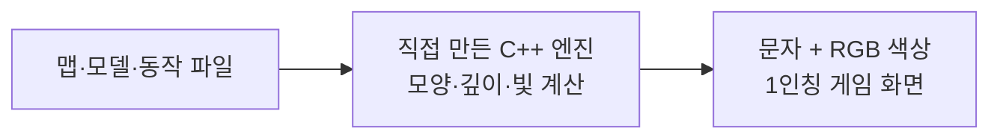
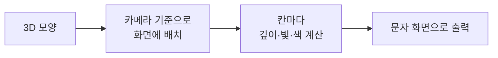
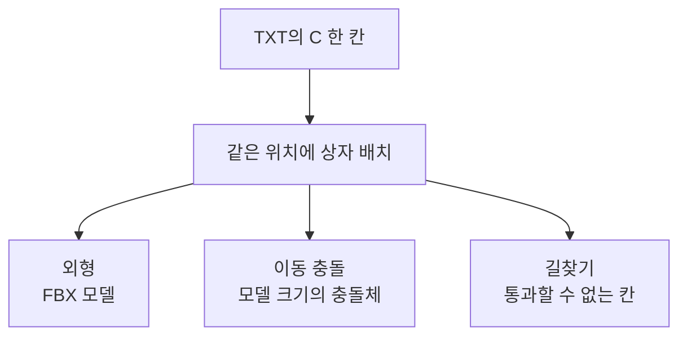
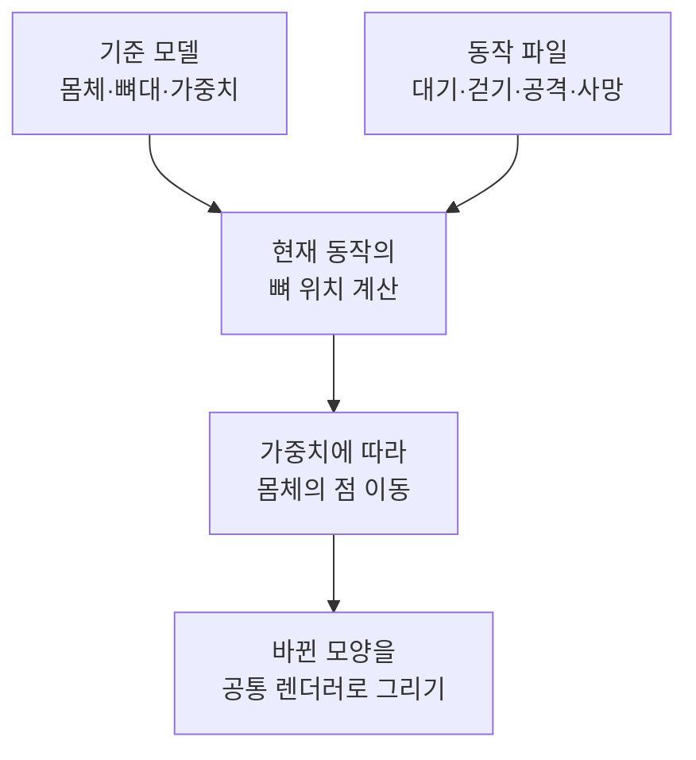
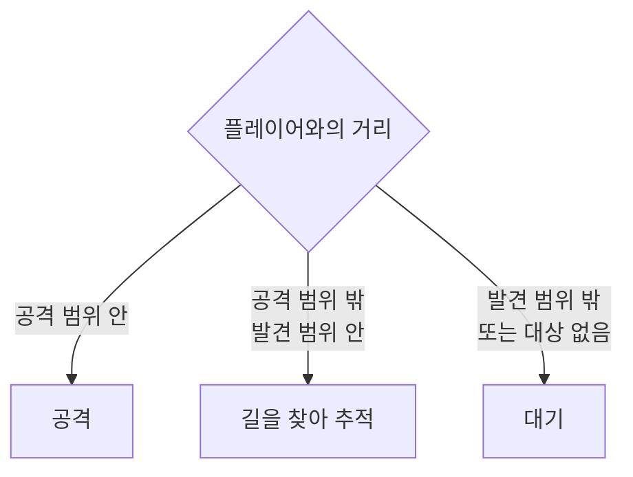
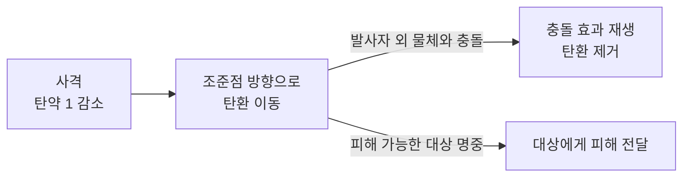
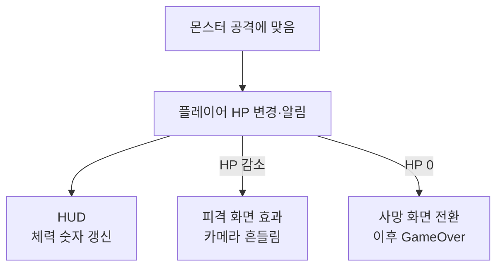
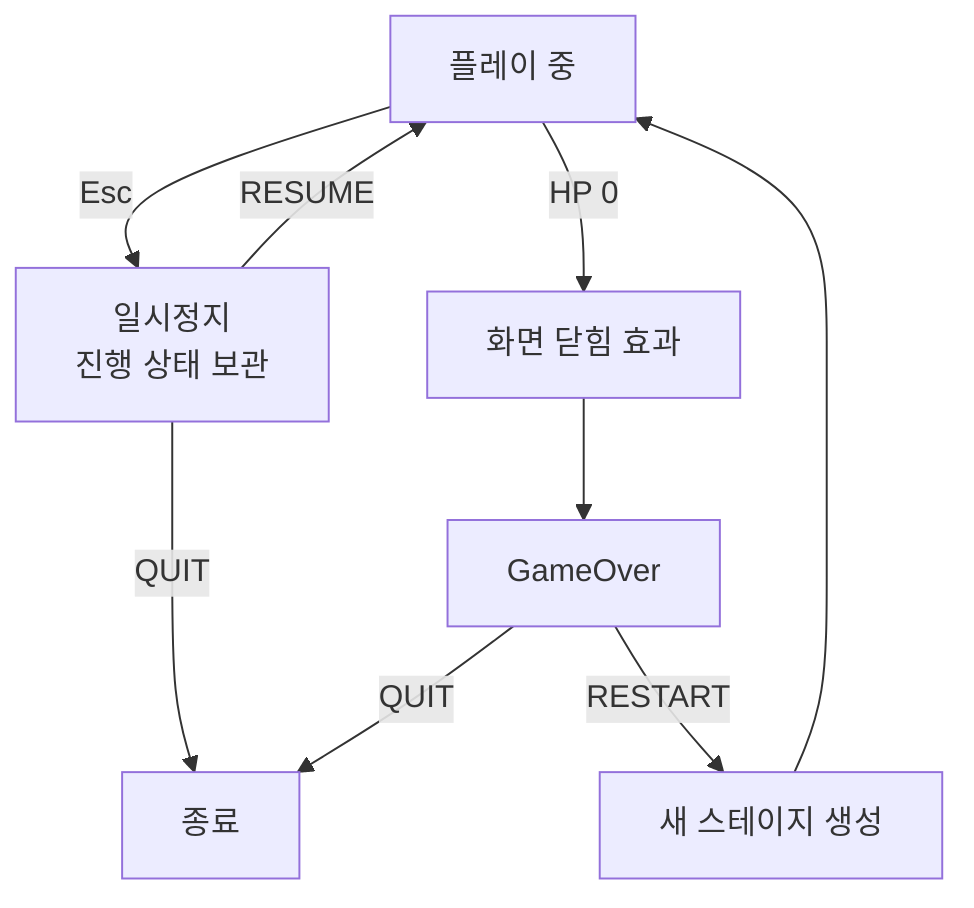
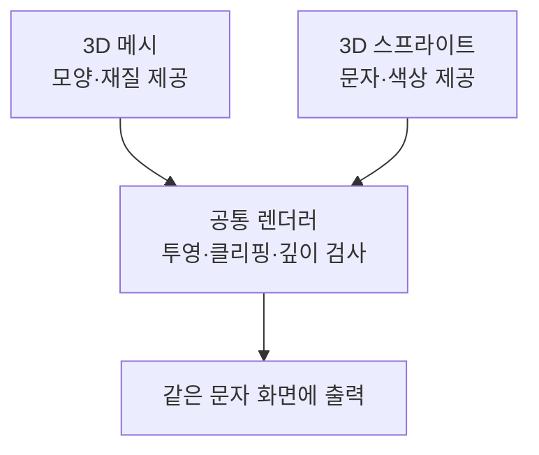
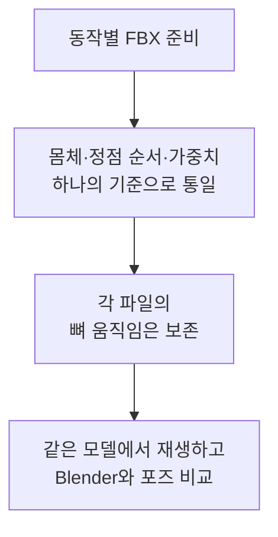

# ASCII Doom

https://github.com/user-attachments/assets/31e2e76d-bf96-4367-9f9f-1c5504e425ce

**자체 엔진으로 3D 공간을 문자와 RGB 색상으로 그린 게임입니다.**



| 구분 | 구성 |
|---|---|
| 기술 구성 | C++17 · Windows API · GDI |
| 실행 기준 | Windows x64 · Release |
| 직접 구현 | 렌더링, 길찾기, 모델 데이터 변환, 게임 로직 |
| 사용한 외부 코드 | FBX 읽기: [ufbx](../HiwoongEngine/AsciiDoomCore/ThirdParty/ufbx.h) / PNG 읽기: [stb_image](../HiwoongEngine/AsciiDoomCore/ThirdParty/stb_image.h) |

[주요 기능](#주요-기능) · [핵심 구현](#핵심-구현) · [문제 해결](#문제-해결-과정) · [구조와 역할](#전체-구조와-역할) · [실행과 조작](#실행과-조작) · [개발 기록](#개발-기록)

## 주요 기능

| 게임에서 할 수 있는 일 | 연결한 기능 |
|---|---|
| 맵을 돌아다니기 | TXT 배치, 벽·소품 충돌, 손전등·천장 조명 |
| 몬스터와 싸우기 | 3D 애니메이션, 경로 추적, 사격·근접 공격, 피해·사망 |
| 상태 확인하기 | 체력·탄약 HUD, 피격 화면 효과·카메라 흔들림 |
| 멈추고 이어 하기 | 일시정지·재개 |
| 죽은 뒤 다시 시작하기 | GameOver·재시작·종료 |

## 핵심 구현

### 3D 모양을 문자 화면으로 바꾸기

**3D 모양을 화면에 배치하고, 각 칸에 쓸 문자와 색을 계산합니다.**



| 계산 | 화면에서 보이는 결과 |
|---|---|
| 투영·클리핑 | 카메라에서 보이는 모양을 화면에 배치 |
| 깊이 검사 | 가까운 물체가 뒤의 물체를 가림 |
| 밝기 → 문자 밀도 | 빛이 닿는 정도에 따라 다른 문자 사용 |
| 텍스처·광원 색 → RGB | 벽·모델의 재질과 조명 색 표현 |

```text
어두움                                      밝음
  공백   .   :   -   =   +   *   #   %   @
```

메시와 3D 스프라이트는 투영·클리핑·깊이 처리를 공유합니다. 문자와 색을 고르는 방식은 각 렌더 컴포넌트가 제공합니다.

관련 코드: [공통 렌더러](../HiwoongEngine/src/Render/MeshRenderer.cpp), [문자·텍스처 선택](Component/MeshRenderComponent.cpp), [창 출력](../HiwoongEngine/src/Render/WindowRenderOutput.cpp)

### TXT 문자로 맵 배치하기

**TXT의 한 칸이 게임 공간의 한 칸에 대응합니다.** 아래는 배치 원리를 보여주는 7×5 예시입니다.

```text
#######
#P.C.M#
#..B..#
#.IHL.#
#######
```



천장에 있는 보·조명 아래는 길찾기를 허용합니다. 실제 이동은 충돌체로 검사하며, X축과 Z축을 따로 확인해 벽에 막히지 않은 방향으로 움직입니다.

관련 코드: [실제 맵](Assets/Maps/Level01.txt), [문자별 배치](Map/DoomMap.cpp), [타일 빌더](Map/BuildImplements), [소품·충돌체 구성](GameObject/MapPropObject.cpp), [이동 검사](Player/Player.cpp)

### 뼈 움직임으로 3D 모델 움직이기

**스키닝은 뼈의 움직임에 맞춰 몸체의 점들을 움직이는 계산입니다.**



| 데이터 | 의미 |
|---|---|
| 메시 | 몸체를 이루는 점과 삼각형 |
| 관절·가중치 | 어느 뼈가 각 점을 얼마나 움직이는지 |
| 애니메이션 클립 | 시간에 따른 뼈의 움직임 |

Zombie 기준 모델에 `Idle`·`Move`·`Attack`·`Dead` 클립을 붙입니다. 포즈·스키닝은 CPU에서 계산하고, `ModelAnimationComponent`가 재생과 화면 반영을 연결합니다.

관련 코드: [모델·클립 로딩](Main.cpp), [모델 데이터 변환](../HiwoongEngine/AsciiDoomCore/ModelImport), [포즈·스키닝 계산](../HiwoongEngine/AsciiDoomCore/Animation), [애니메이션 재생](Component/ModelAnimationComponent.cpp)

### 거리에 따라 달라지는 몬스터 행동

**몬스터는 플레이어와의 거리를 보고 대기·추적·공격을 선택합니다.**



| 담당 | 하는 일 |
|---|---|
| Monster | 행동 선택, 경로를 따라 이동, 재탐색 시점 결정 |
| NavAIComponent·IPathFinder | 현재 위치부터 목적지까지의 경로 계산 |
| ModelAnimationComponent | 선택한 동작 재생 |
| AttackObject | 공격이 유효한 구간에 충돌한 대상에게 피해 전달 |

A*는 상하좌우·대각선으로 경로를 찾으며, 벽 모서리를 가로지르는 대각선 이동은 막습니다.

**공격 동작의 판정 구간**

| 시작~45% | 45~50% | 50~100% |
|---|---|---|
| 준비 동작 | 충돌한 대상에 피해 전달 | 마무리 동작 |

공격 동작을 마친 뒤 거리 조건을 다시 반영합니다. HP가 0이 되면 즉시 공격을 끊고 사망 동작을 재생하며, 동작 종료 후 일정 시간이 지나면 제거됩니다.

관련 코드: [행동·이동](GameObject/Monster.cpp), [경로 요청](Component/NavAIComponent.cpp), [A* 탐색](../HiwoongEngine/AsciiDoomCore/PathFinder/Implements/AStarPathFinder.cpp), [공격 피해](GameObject/AttackObject.cpp)

### 사격·피격과 화면 반응

**사격은 탄환을 만들고, 충돌은 피해와 효과로 이어집니다.**



**플레이어의 체력이 바뀌면 필요한 기능이 각각 알림을 받습니다.**



| 동작 | 처리 |
|---|---|
| 피해 전달 | `IDamageable` 계약 사용. 같은 공격에서 같은 대상을 중복 처리하지 않음 |
| 재장전 | 재장전 동작 종료 후 탄약을 최대치로 채움 |
| 탄약 HUD | 탄약 값이 실제로 바뀌었을 때 표시 갱신 |

관련 코드: [총](Player/Gun.cpp), [탄환](GameObject/Bullet.cpp), [피해 계약](Interfaces/IDamageable.h), [HUD](UI), [플레이어 피격 효과](Component/PlayerHitEffectComponent.cpp)

### 게임 멈추기·다시 시작하기



| 선택 | 게임 상태 |
|---|---|
| RESUME | 보관했던 같은 Scene으로 복귀. 위치·HP·탄약 유지 |
| RESTART | 새 Scene 생성. 길찾기와 읽어 둔 모델 데이터 재사용 |

관련 코드: [일시정지 메뉴](Scene/MenuScene.cpp), [사망·재시작 연결](Scene/DoomScene.cpp), [GameOver 메뉴](Scene/GameOverScene.cpp)

## 문제 해결 과정

### 1. 길찾기를 게임 밖에서 반복 검증하기

| 어려웠던 점 | 바꾼 방법 | 확인할 수 있는 것 |
|---|---|---|
| 원하는 위치·벽 배치를 매번 플레이로 재현 | 작은 격자를 테스트 입력으로 사용 | 직선·대각선·벽 우회·도달 불가 |
| 자료구조·탐색·이동 오류가 섞임 | 최소 힙과 A*를 따로 검사 | 어느 계산에서 잘못됐는지 |


길찾기는 `AsciiDoomCore`에 두고, 게임에서는 `IPathFinder` 계약으로 사용합니다. `DoomInstaller`가 사용할 구현체를 만들어 전달하는 수동 DI 구조입니다.

관련 코드: [길찾기·최소 힙 테스트](../HiwoongEngine/AsciiDoomTests/PathFinder/AStarPathFinderTests.cpp), [구현체 조립](Bootstrap/DoomInstaller.cpp)

### 2. 메시와 스프라이트가 같은 렌더러 사용하기



| 정리한 책임 | 효과 |
|---|---|
| 각 컴포넌트는 자기 모양·문자·색상 제공 | 표현 방식만 다르게 구성 |
| 렌더러는 공통 계산 담당 | 같은 투영·깊이 계산을 중복 관리하지 않음 |
| 클리핑할 때 위치와 UV를 함께 보간 | 잘린 부분도 원래 표면의 문자·색상 선택 |

관련 코드: [공통 계약](../HiwoongEngine/src/Render/IRenderable3D.h), [공통 렌더러](../HiwoongEngine/src/Render/MeshRenderer.cpp), [3D 스프라이트](../HiwoongEngine/src/Component/SpriteRenderer3DComponent.cpp)

### 3. FBX 파일마다 달랐던 몸체 기준 맞추기

모델 교체 실험에서는 FBX가 정상적으로 읽혀도 Blender와 엔진의 포즈가 다르게 보이는 문제가 있었습니다.



| 비교 기준 | 확인하는 내용 |
|---|---|
| 같은 메시·가중치 | 몸체 준비 차이로 생기는 오차 분리 |
| 같은 좌표축·시간 | 같은 동작의 같은 순간을 비교 |

모델 교체를 위한 에셋 준비 사례이며, 게임의 기본 모델은 Zombie입니다.

관련 코드: [모델 변환](../HiwoongEngine/AsciiDoomCore/ModelImport/ModelImporter.cpp), [관절 포즈](../HiwoongEngine/AsciiDoomCore/Animation/SkeletonPoseCalculator.cpp), [스키닝](../HiwoongEngine/AsciiDoomCore/Animation/SkinningCalculator.cpp)


| 역할 | 주요 담당 |
|---|---|
| 맵 배치·스폰 위치·길찾기 격자 | [DoomMap](Map/DoomMap.cpp) |
| 플레이어 이동·HP·탄약 | [Player](Player/Player.cpp) |
| 몬스터 행동·경로 이동 | [Monster](GameObject/Monster.cpp) |
| 경로 계산 연결 | [NavAIComponent](Component/NavAIComponent.cpp) |
| 동작 재생·포즈 적용 | [ModelAnimationComponent](Component/ModelAnimationComponent.cpp) |
| 충돌 검사 / 공격 피해 전달 | [CollisionSystem](../HiwoongEngine/src/Physics/CollisionSystem.cpp) / [AttackObject](GameObject/AttackObject.cpp) |
| HUD 배치·값 표시 | [PlayerHUID](UI/PlayerHUID.cpp)·[UI](UI) |

객체를 생성한 관계와 Transform의 부모·자식 관계는 별개입니다. `PlayerHUID`는 소스에서 사용하는 HUD 클래스 이름입니다.

## 실행과 조작

### Release 빌드와 실행


에셋 고지: [환경 에셋 라이선스](Assets/Environment/CeilingLight/LICENSE.txt), [Freedoom 텍스처 고지](Assets/Textures/Freedoom/COPYING.adoc)

### 조작

| 하고 싶은 일 | 입력 |
|---|---|
| 이동 | `W` 전진 · `S` 후진 · `A` 왼쪽 · `D` 오른쪽 |
| 시점 회전 | 마우스 좌우 또는 `Q` / `E` |
| 조준점 위아래 이동 | 마우스 상하. 이동 범위 제한 |
| 사격 / 재장전 | 마우스 왼쪽 클릭 / `R`. 탄약이 없을 때 클릭해도 재장전 요청 |
| 일시정지 / 재개 | `Esc` |
| 메뉴 선택 / 실행 | `↑`·`↓` / `Enter` |

## 개발 기록

각 항목을 펼치면 당시의 시연을 볼 수 있습니다. 초기 몬스터 영상은 2D 스프라이트 방식이며, Step 14부터 3D 메시·애니메이션 전환 과정을 담았습니다.

<details>
<summary>Step 1. 맵 렌더링과 플레이어 이동</summary>

https://github.com/user-attachments/assets/865c266e-8450-480e-a423-dcdda1b79d45

</details>

<details>
<summary>Step 2. 손전등</summary>

https://github.com/user-attachments/assets/5a2b94c3-1b5d-4a2d-8865-a76ca032c596

</details>

<details>
<summary>Step 3. 총과 조준점 표시</summary>

https://github.com/user-attachments/assets/ad7fd86f-5ee3-47ba-800e-8a30ebba1aff

</details>

<details>
<summary>Step 4. 일시정지 메뉴</summary>

https://github.com/user-attachments/assets/472910dd-32d5-4a0f-b779-d556f6dc4e8c

</details>

<details>
<summary>Step 5. 마우스 커서 숨기기</summary>

https://github.com/user-attachments/assets/da1e2ae7-e510-43eb-9f87-d4b80016d05d

</details>

<details>
<summary>Step 6. HP·AMMO UI</summary>


</details>

<details>
<summary>Step 7. 발사 애니메이션</summary>

https://github.com/user-attachments/assets/add28a26-4993-4756-ac9e-6a16d6e0a38a

</details>

<details>
<summary>Step 8. 재장전 애니메이션</summary>

https://github.com/user-attachments/assets/4a433b47-2877-48de-bc82-da66d511ef53

</details>

<details>
<summary>Step 9. 탄환 발사 및 피격 효과</summary>

https://github.com/user-attachments/assets/98f8e1cd-fc63-4a95-9056-60def4282a98

</details>

<details>
<summary>Step 10. 적 테스트</summary>

https://github.com/user-attachments/assets/4320f76c-edb7-43d7-a17d-4f33a0b32d38

</details>

<details>
<summary>Step 11. 길찾기 알고리즘</summary>

https://github.com/user-attachments/assets/e4fcf815-cd4e-40b7-b00a-c392d1a5de45

</details>

<details>
<summary>Step 12. 애니메이션 상태 변경</summary>

https://github.com/user-attachments/assets/5fe08a5e-9f18-4f6a-a9cd-0fca11ac458e

</details>

<details>
<summary>Step 13. 문자 셀별 색상 표시</summary>

https://github.com/user-attachments/assets/b942b436-fb5e-4eb5-ae30-a69bb85c9eeb

</details>

<details>
<summary>Step 14. 몬스터의 2D 스프라이트에서 3D 메시로 전환</summary>

**1. FBX 메시 불러오기**

https://github.com/user-attachments/assets/beae9df2-e230-4d57-ae9d-7412b1c976b0

**2. UV 매핑**

https://github.com/user-attachments/assets/9676c227-d0d1-4a04-aa30-9be947be6c2f

**3. 애니메이션**

https://github.com/user-attachments/assets/745eb1be-686a-4f3c-84c6-df437a77ef4b

https://github.com/user-attachments/assets/29db8578-6d9d-4685-bcf5-1cb5c9d7054f

https://github.com/user-attachments/assets/a587d522-dd43-43e6-b936-a2b5dfd70ab4

https://github.com/user-attachments/assets/1a291b9e-4f09-4719-a87f-283d3b530960

</details>

<details>
<summary>Step 15. 디버깅 툴</summary>

https://github.com/user-attachments/assets/8c2243a4-dbe0-4dff-b0a9-fcb99bb69736

</details>

<details>
<summary>Step 16. 피격 효과(스프라이트 애니메이션 + 카메라 쉐이킹)</summary>

https://github.com/user-attachments/assets/0ebdb595-f1f2-4d75-a93b-43893689d83a

</details>

<details>
<summary>Step 17. GameOver UI</summary>

https://github.com/user-attachments/assets/56c527b8-fe3b-4dcb-b732-2340e3464220

</details>
