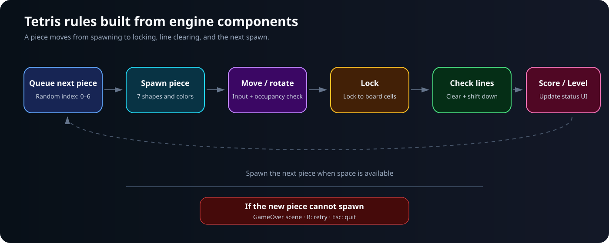

<p align="right">
  <a href="README.md"></a>
  <a href="README.en.md"></a>
</p>

# ASCII Tetris


A console Tetris game built by combining HiwoongEngine's Scenes, Components, parent-child Transforms, and character rendering. Move and rotate seven types of pieces to clear lines, with the level and automatic drop speed changing as your score increases.

The engine handles input, object lifecycles, and screen output. The game separates piece behavior, board occupancy, spawning, and status display into distinct responsibilities. This is a 2D example of connecting actual game rules to the shared engine.

## Gameplay Videos

<table>
  <tr>
    <td align="center"><br><sub>Movement · Rotation · Next-Piece UI</sub></td>
    <td align="center"><br><sub>Board Occupancy Checks and GameOver Transition</sub></td>
    <td align="center"><br><sub>State Persistence and Drop Speeds by Level</sub></td>
  </tr>
</table>

## Controls and Running the Game

| Key | Action |
|---|---|
| `←` / `→` | Move one cell left or right |
| `↓` | Move one cell down |
| `↑` | Rotate 90 degrees clockwise. The O piece does not rotate |
| `Space` | Drop instantly to the lowest available position and lock the piece |
| `Esc` | Exit |
| `R` on GameOver | Enter a new game Scene with a fresh board |

Key input uses `GetKeyDown()`, so each action is applied once on the frame when the key is first pressed. Automatic dropping accumulates elapsed time separately from input.


## Structure and Responsibilities

| Element | Responsibility | Implementation |
|---|---|---|
| `TestScene` | Create the map, board, and UI; handle level-ups and the GameOver transition | [TestScene.cpp](Scene/TestScene.cpp) |
| `TetrisModule` | Move, rotate, drop, and lock a piece made of four cells | [TetrisModule.cpp](Interface/TetrisModule.cpp) |
| `PlayerInputComponent` | Convert key presses into requests for piece actions | [PlayerInputComponent.cpp](GameObject/Player/PlayerInputComponent.cpp) |
| `Block` | Display a single colored `@` cell using `SpriteRendererComponent` | [Block.cpp](GameObject/TetrisBlocks/Block.cpp) |
| `TetrisBoard` | Check cell occupancy, remove completed lines, and move the blocks above them | [TetrisBoard.cpp](GameObject/BackGround/TetrisBoard.cpp) |
| `SpawnManager` | Spawn pieces, reserve the next piece, and check occupancy at the spawn position | [SpawnManager.cpp](GameObject/SpawnManager/SpawnManager.cpp) |
| `TetrisGameState` | Retain the score, level, target score, and next-piece index across Scenes | [TetrisGameState.cpp](Manager/TetrisGameState.cpp) |
| `GameStatesUI` | Read shared state to display the score, level, and next piece | [GameStatesUI.cpp](Scene/GameStatesUI.cpp) |

`TetrisModule` and `Block` are `GameObject` instances, with input and character output attached as separate Components. Board occupancy data lives in a separate object owned by `TestScene`, keeping the displayed characters separate from the game rules.

## From Spawning a Piece to Clearing Lines



1. `SpawnManager` creates one of I, O, T, L, J, S, or Z using the reserved index.
2. It checks that all four cells of the new piece are empty at the spawn position. If any are blocked, it requests GameOver.
3. `TetrisModule` prepares four child `Block` objects and an input Component. The next-piece index is available in the UI.
4. Each movement or rotation request checks candidate coordinates against the board and changes the coordinates only if the move is valid.
5. When automatic dropping is blocked or an instant drop finishes, the four Blocks are registered in board cells, and completed lines are removed.
6. A lock-completion callback notifies `SpawnManager`, which spawns the next piece.

### Moving Four Blocks as One Piece

Each piece class defines four local coordinates, a color, and a rotation center, reusing the shared behavior in `TetrisModule`. The declarations for each piece are grouped in [TetrisBlocks/TetrisModule.h](GameObject/TetrisBlocks/TetrisModule.h).

`TetrisModule::Start()` creates four Blocks in the Scene and sets itself as their parent using `SetParent(..., false)`. Moving the parent piece also changes the world positions of its child Blocks.

```text
Block world position = TetrisModule world position + Block local position
```

The Scene manages the actual object lifetimes. Both the piece's Block references and the board's Block references use `weak_ptr`. Parent-child relationships and coordinate calculations use the engine's [GameObject](../HiwoongEngine/src/GameObject/GameObject.cpp) and [TransformComponent](../HiwoongEngine/src/Component/TransformComponent.cpp).

### Checking Occupancy Before Moving or Rotating

`CanMove()` computes four candidate cells by adding the piece's world position, each Block's local position, and the movement direction. It moves the parent piece only when `TetrisBoard::IsOccupied()` reports that every cell is empty. Positions outside the board are also treated as occupied, so the same check handles both boundaries and stacked blocks.

Rotation transforms the coordinates `(x, y)` relative to the rotation center into `(-y, x)`. Because the positive y-axis points downward on the screen, this produces a 90-degree clockwise rotation. All four candidate cells are checked before the local coordinates are applied together, preserving the original shape if the rotation would collide.

Rotation is disabled for the O piece. The other pieces each use an integer-coordinate rotation center. Wall kicks, which adjust a piece's position when rotating against a wall, are not implemented.

### Updating Board Data and Display Objects Together

`TetrisBoard` uses two one-dimensional arrays, with cells indexed by `y * width + x`. `cells` stores whether a wall or locked Block occupies a cell, while `blockCells` stores a weak reference to the Block in that cell. A moving piece is not registered on the board until it locks.

The current [map.txt](../HiwoongEngine/Assets/Stages/map.txt) is 12×22 cells including the border, with a 10×20-cell play area. `TestScene::LoadMap()` creates walls at `#` positions and registers the same coordinates on the board.

When a piece locks, the Blocks' world coordinates are recorded on the board, and each row inside the border is checked for completion. Blocks in completed rows are scheduled for deletion, and their cells are cleared. The rows above are then traversed from bottom to top, moving each Block and the entries in both arrays down by one cell so that Blocks already moved are not processed again.

## Score, Levels, and Scene Transitions

`TetrisGameState` persists as a function-local static instance. Replacing the Scene and rebuilding the board allows the score, level, and next-piece index to carry over.

| Rule | Current Implementation |
|---|---|
| Line-clear score | 10 points per line |
| Initial state | 0 points, level 1, and a 100-point target for the next level |
| Level-up | When the total score reaches or exceeds the target, increase the level by 1 and the next target by 200 points |
| Automatic drop interval | `max(0.1, 1.0 - (level - 1) * 0.1)` seconds |
| Level transition | Replace the Scene with a new `TestScene`, resetting the board while retaining shared state |
| GameOver | Switch to the `GameOver` Scene if the next piece's spawn position is occupied |

Pieces automatically fall one cell every 1 second at level 1 and every 0.9 seconds at level 2, with a minimum interval of 0.1 seconds. `TestScene::Update()` checks for level-ups, and each new piece takes the drop interval for the current level when it starts.

Pressing `R` on GameOver enters a new `TestScene`. The current [GameOver.cpp](Scene/GameOver.cpp) does not call `TetrisGameState::Reset()`, so **only the board starts fresh; the score, level, and next piece are retained**. The state-reset function itself is defined in [TetrisGameState](Manager/TetrisGameState.cpp).

## Next Piece and Status UI

After creating the current piece using the reserved index, `SpawnManager` picks the next index from 0 through 6 and stores it in the shared state. It draws a random number from this range each time; it does not shuffle and exhaust all seven piece types as a seven-bag system would.

`GameStatesUI` updates text when the score, level, target score, or next index differs from the previously displayed value. The preview changes the positions and colors of four `TextObject` instances displaying `@` to match the piece type. It reuses [TextObject](GameObject/TextObject.h), which uses the engine's `SpriteRendererComponent`, without creating Blocks for the game board.
