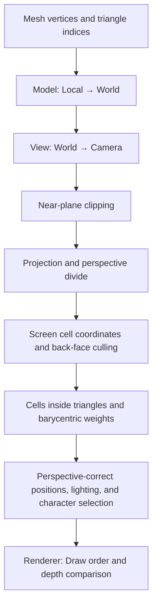

[한국어](README.md) | **English**

# HiwoongEngine

**A 2D and 3D ASCII game engine built in C++, with game architecture and rendering implemented from scratch.**

Games are composed of Scene, GameObject, and Component objects, and 3D scenes computed on the CPU are displayed using characters and colors. ASCII Doom, ASCII Cube, and ASCII Tetris share the same engine and demonstrate how it works from input to screen output.

<br>
</br>


## Games Built with the Engine

### [1. ASCII Doom](AsciiDoom/README.md)

A first-person demo in development, featuring movement through a 3D map, lighting, a pause menu, and health and ammo UI.

https://github.com/user-attachments/assets/81984e31-71cc-48f2-ba54-3f6739af3593

### [2. ASCII Cube](AsciiCube/README.md)

A 3D rendering demo that uses a rotating cube to demonstrate coordinate transformations, triangle filling, depth testing, and normal-based lighting.

https://github.com/user-attachments/assets/639897e7-3dc8-43dd-8a19-020b15c6207a

### [3. ASCII Tetris](AsciiTetris/README.md)

A game that applies the engine's 2D object structure and scene transitions to block movement, rotation, falling, line clearing, scoring, and levels.

<table align="center">
  <tr>
    <td align="center"><a href="AsciiTetris/README.md"></a><br><sub>Gameplay</sub></td>
    <td align="center"><a href="AsciiTetris/README.md"></a><br><sub>Game Over</sub></td>
    <td align="center"><a href="AsciiTetris/README.md"></a><br><sub>Level Up</sub></td>
  </tr>
</table>

---

## About the Engine

HiwoongEngine is a project for understanding and implementing how a game produces a frame. It began with the 2D foundations needed for Tetris, then expanded into 3D ASCII scenes with vector and matrix operations and software rasterization.

The core design **separates responsibilities for game rules, features attached to objects, rendering calculations, and actual screen output**. All three games use a shared engine DLL within one repository and solution.

| Area | Implementation | Key Code |
|---|---|---|
| Execution flow | Frame timing, input, updates, drawing, and scheduled scene transitions | [Engine](HiwoongEngine/src/Engine/Engine.cpp) |
| Object composition | Scene object management, Component addition and lookup, and lifecycle | [Scene](HiwoongEngine/src/Scene/Scene.h), [GameObject](HiwoongEngine/src/GameObject/GameObject.h) |
| Coordinates and math | Position, rotation, scale, parent position inheritance, and vector and matrix operations | [TransformComponent](HiwoongEngine/src/Component/TransformComponent.cpp), [Math](HiwoongEngine/src/Math) |
| 2D rendering | Text sprites, transparent spaces, and per-cell draw order | [SpriteRendererComponent](HiwoongEngine/src/Component/SpriteRendererComponent.cpp) |
| 3D rendering | Perspective projection, near-plane clipping, back-face culling, triangle filling, and depth testing | [MeshRenderer](HiwoongEngine/src/Render/MeshRenderer.cpp), [SoftwareRasterizer](HiwoongEngine/src/Render/SoftwareRasterizer.cpp) |
| Lighting | Ambient brightness, directional light, and spotlights accounting for distance, angle, and surface orientation | [RenderView](HiwoongEngine/src/Render/RenderView.h), [SpotLight](HiwoongEngine/src/Render/SpotLight.h) |
| Input and movement checks | Key state changes, mouse movement and locking, and AABB checks at proposed positions | [Input](HiwoongEngine/src/Core/Input.cpp), [CollisionSystem](HiwoongEngine/src/Physics/CollisionSystem.cpp) |

The technology stack is **C++17 · Windows API · Win32 Console · GDI**. Vertex transformations and triangle rasterization run on the CPU, and the final result is displayed as character cells.

## How It Works

### 1. Scene → GameObject → Component


`Input` is a separate object managed by the engine. In Tetris, `PlayerInputComponent` reads key states from this object to handle movement and rotation.

```text
Engine
├─ Input                         Input states and mouse movement
├─ Renderer                      Draw commands and the completed frame
│  └─ IRenderOutput              Output to the console or a Win32 window
└─ Scene                         Objects and lifecycle of the current scene
   └─ GameObject
      ├─ TransformComponent      Default position, rotation, and scale
      └─ Additional Components   Object-specific features such as rendering and input
```

Every `GameObject` has a `TransformComponent` by default. Features are attached with `AddComponent<T>()` and retrieved with `GetComponent<T>()`. Components can also access other Components through their owning GameObject.

A Scene holds its GameObjects, and each GameObject holds its Components. References back to the owning Scene or GameObject, as well as parent-child object relationships, use `weak_ptr`. This separates object lifetime management from connections between objects.

Parent-child Transforms currently support **position composition**.

```text
Child world position = Parent world position + Child local position
Model matrix = Translation × Rotation × Scale
```

The Model matrix uses the world position for translation and the Transform's own values for rotation and scale. Hierarchical matrix calculations that also accumulate parent rotation and scale are outside the current implementation.

Component lookup uses type IDs and parent-type checks from [HiwoongObject](HiwoongEngine/src/Core/HiwoongObject.h). These IDs distinguish types at runtime.

### 2. Frame Execution Order


Once the configured frame interval has elapsed, `Engine::Run()` reads input and passes the actual elapsed time, `deltaTime`, to `Update()`. Initialization and `Start()` check each object's state and run once for objects that need them.

GameObject additions and removals, as well as Component additions, use deferred lists. Changes are applied at designated points at the end of the frame, without immediately modifying a list being traversed.

Scene transitions are also scheduled through `nextScene`. When pausing, the current game scene is kept in `pausedScene`, and the characters and colors of the last frame are captured. The game scene retains its state while the menu runs, and resuming returns to the stored scene.

Related code: [Engine.cpp](HiwoongEngine/src/Engine/Engine.cpp), [Scene.cpp](HiwoongEngine/src/Scene/Scene.cpp)

### 3. Compositing 2D and 3D Results into One Character Frame


`SpriteRendererComponent` reads text line by line and submits non-space runs to the Renderer. Each character's position accounts for the GameObject's world position. This keeps empty space around sprites from obscuring the scene behind them.

`Renderer` collects text, line, and 3D cell commands, then builds a frame using these three arrays.

| Per-Cell Data | Role |
|---|---|
| `RenderCell` | The character and RGB color to display |
| `sortingOrder` | Display priority among overlapping 2D elements and the 3D scene |
| Depth Buffer | Selects the nearest surface among 3D cells with the same draw order |

Screen coordinates `(x, y)` map to an array index using `y * width + x`. Elements with a higher `sortingOrder` take priority. Among 3D cells with the same order, the smaller depth value is retained. This allows 3D scenes and character-based UI to be composited into a single frame.

Related code: [Renderer.cpp](HiwoongEngine/src/Render/Renderer.cpp)

### 4. How 3D Triangles Become ASCII Characters


`MeshRenderer`, the shared 3D rendering path, processes the scene in this order.



- **Coordinate transformation:** Model, View, and Projection matrices transform objects into screen coordinates from the camera's perspective. The width-to-height ratio of a character cell is also included in the screen aspect ratio calculation.
- **Near-plane clipping:** Triangles that cross the boundary just in front of the camera are clipped by calculating intersection points. If the clipped result is a quadrilateral, it is split into triangles again.
- **Triangle filling:** After back-facing triangles are excluded in screen space, cells inside each triangle are found. Barycentric coordinates are weights that describe how much each cell reflects the values at the three vertices.
- **Perspective correction:** The inverse camera-space depth, `1/z`, is applied to screen-space weights to reconstruct each cell's 3D position. Lighting is calculated at that position, while the depth buffer uses post-projection depth interpolated with screen-space weights.

Brightness combines ambient brightness, directional light, and spotlights. Spotlights account for **distance from the light, angle from its central direction, and surface normal direction**. The calculated brightness maps to a character array, producing characters of different densities such as `' '`, `.`, `:`, `*`, `#`, and `@`.

Related code: [MeshRenderer.cpp](HiwoongEngine/src/Render/MeshRenderer.cpp), [SoftwareRasterizer.cpp](HiwoongEngine/src/Render/SoftwareRasterizer.cpp), [Matrix4x4.cpp](HiwoongEngine/src/Math/Matrix4x4.cpp)

### 5. Input and Movement Checks

Keyboard input compares the current and previous frame states to distinguish a held key with `GetKey`, the initial press with `GetKeyDown`, and release with `GetKeyUP`.

Mouse movement is reset each frame before new movement is read. A target window can be specified for mouse locking. While locked, the cursor is confined to that window and returned to its center. `MouseLookComponent` applies horizontal mouse movement to rotation.

For 3D movement, AABB checks are performed between `BoxCollider3DComponent` objects at the proposed position. An AABB is a box aligned with the coordinate axes. If the ranges are separate along any of the X, Y, or Z axes, the boxes do not overlap. The games currently use `Scene::CanMoveTo()` to check whether movement is allowed.

Related code: [Input.cpp](HiwoongEngine/src/Core/Input.cpp), [MouseLookComponent.cpp](HiwoongEngine/src/Component/MouseLookComponent.cpp), [BoxCollider3DComponent.cpp](HiwoongEngine/src/Component/BoxCollider3DComponent.cpp)


